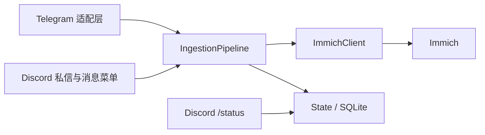

# Discord 单向导入 Immich：项目可行性评估与 API 调研

调研日期：2026-10-30。本文记录代码检查、官方资料及方案访谈。Q1–Q18 与测试边界已确认，用户调用 to-spec 后，规格已发布为 [GitHub Issue #1](https://github.com/Myraxion/immich-telegram-bot/issues/1)，标签为 `ready-for-agent`。后续实现以该 Issue 为准；[本地规格](discord-import-spec.md) 为发布正文副本。尚未修改运行代码，也未进行真实 Discord 应用联调。

## 方案访谈：已确认范围

2026-10-30，用户确认第一轮 Q1–Q5 全部采用建议：

- Q1：每套部署配置一个 Immich 账号；只有白名单中的 Discord 用户可触发导入，所有人导入同一个账号的媒体库。
- Q2：通过用户安装应用，在服务器、人与人私聊和群私聊使用消息菜单；不要求机器人加入目标服务器或聊天，仅处理用户主动选中的目标消息。
- Q3：消息菜单一次保存该消息中的全部受支持附件，首版不提供附件勾选界面。
- Q4：Discord 首版仅处理原生照片、视频和压缩包附件；网页链接预览、贴纸和转发消息快照不纳入。
- Q5：支持仅 Telegram、仅 Discord、两者同时启用，兼容已有 Telegram 使用方式；仅 Discord 模式不要求 Telegram 凭据或 Bot API 容器。

用户随后确认第二轮 Q6–Q10 全部采用建议：

- Q6：Discord 默认目标相册为 `Discord Inbox`；相册名和命名模板可配置，菜单不增加相册选择步骤。Telegram 的现有配置行为保持兼容。
- Q7：Discord 附件默认保留原始文件名，允许使用命名模板；压缩包内媒体保留条目文件名。
- Q8：Telegram 与 Discord 导入的完全相同文件共用一份 Immich 资产；按文件内容判断，不做视觉相似去重。压缩、转码或修改元数据导致内容不同的文件可作为不同资产。
- Q9：一批导入允许部分成功；保留成功资产，明确报告失败附件，允许再次触发导入，不回滚成功部分。
- Q10：支持现有 ZIP/RAR/7z/tar 等压缩格式，扫描解压后子目录中的图片和视频；不递归展开嵌套压缩包，不提供密码输入；非媒体跳过，需要密码的包明确报错。

用户随后确认第三轮 Q11–Q15 全部采用建议：

- Q11：重复资产也关联本次目标相册；例如 Telegram 已导入的照片从 Discord 再保存时，复用原资产并加入 `Discord Inbox`。相册关联是本次导入的一部分，失败需明确报告并允许手动补齐，不能仅写日志后当作完整成功。
- Q12：首版失败后手动再次触发，跳过已成功部分；服务重启不自动恢复未完成导入，不增加持久化任务队列。
- Q13：菜单状态与结果仅向调用者展示，私信入口直接回复私信；结果包含成功、重复、跳过、失败数量及失败文件名和简短原因。新增 `/status`，供调用者查询自己的最近几次导入状态和结果；菜单交互超过回复时限时通过该命令查询，不额外发送完成私信。
- Q14：单个 Discord 附件默认上限 2000 MiB，每包默认最多 1000 个媒体文件，均可配置。超大附件拒绝下载；媒体数量超限拒绝导入整个包并明确提示，不能静默截取前 1000 个。
- Q15：Discord 模板中的 `{source}` 在服务器消息中优先为 `服务器名_频道名`，私聊为原消息作者显示名称；`{sender}` 为原消息作者，消息 ID/时间取被保存的原消息。媒体日期沿用 EXIF 优先、消息时间回退。名称缺失时按 Q16 回退。

用户随后确认第四轮 Q16–Q18 全部采用建议：

- Q16：服务器来源名称缺失时，分别使用服务器 ID、频道 ID 回退；私聊作者没有显示名称时使用用户名。不为补名字而要求机器人入服。
- Q17：导入状态与结果保存到现有 SQLite，`/status` 默认展示当前调用者最近 5 次导入；历史结果在服务重启后仍可查看。重启前未结束的记录标记为“已中断”，等待用户手动再次触发，不恢复执行；状态记录不存成可重放任务队列。
- Q18：同一应用进程根据启用平台运行适配层，共享 Immich 客户端、状态和摄取核心；Discord 使用 Gateway，不新增公网 HTTP 回调。首版共享核心一次执行一批导入，状态查询仍能及时响应；两平台同时启用时随同一进程一起重启。

用户偏好和关键取舍已全部逐项确认，并已确认主要测试边界采用现有 `IngestionPipeline.ingest` 入口，辅以必要的 Discord 入口契约测试及真实账号联调。用户随后调用 to-spec，规格已整理发布；接口实际联调仍为后续验收工作。

## 访谈整合方案（已转为规格）

### 使用行为

| 项目 | 方案 |
| --- | --- |
| 账号与权限 | 每套部署一个 Immich 账号；Discord 使用独立白名单，检查发私信的人或点击菜单的人，不检查目标消息作者是否在白名单内。 |
| 入口 | 私信机器人发送附件；消息菜单 Apps → 保存到 Immich；个人安装应用覆盖服务器、bot 私信、其他私聊及群私聊。 |
| 输入与选择 | 处理目标消息全部受支持的原生照片、视频和压缩包附件；不提供附件勾选、临时相册选择、链接预览抓取、贴纸或转发快照展开。 |
| 保存位置与命名 | 默认 `Discord Inbox`，原始文件名；相册名与命名模板可配置，Discord 默认独立于 Telegram。压缩包内媒体保留条目文件名。 |
| 内容重复 | 完全相同的文件跨平台复用资产，仍确保本次目标相册关联；相册失败可再次触发补齐，避免重新上传。 |
| 文件与压缩包限额 | 每附件 2000 MiB、每包 1000 个媒体文件，可配置；拒绝超大附件或媒体超量的整个包，明确报告。 |
| 压缩包扫描 | 支持现有格式，扫描普通子目录中的媒体；不展开嵌套压缩包，不输入密码；非媒体跳过，需要密码的包报错。 |
| 结果与重试 | 允许部分成功，不回滚已上传资产；菜单私密反馈，私信直接回复；失败由用户重新触发。 |
| 长任务与重启 | `/status` 查询调用者最近 5 次导入，结果持久化；重启将未完成记录标记为中断，不自动恢复。 |
| 部署 | 仅 Telegram、仅 Discord、同时启用；共用进程、核心与 SQLite，批次串行，状态查询保持响应。仅 Discord 不需要 Telegram 专用凭据或容器。 |

### 模块与数据边界

两个传输适配层负责平台鉴权、取文件、构造 `MessageMetadata` 和 `IngestItem`、呈现结果；摄取核心继续负责内容去重、解压、上传、相册关联和完成状态。`IngestBatch` 表示一次导入请求的一组文件，`IngestRecord` 表示该批次供调用者查询的状态与结果。架构取舍见 [ADR-0004](../adr/0004-cross-platform-ingestion-identity-and-completion.md) 和 [ADR-0005](../adr/0005-shared-runtime-and-queryable-ingestion-records.md)。

**来源身份与内容身份分开。** 来源身份包含平台、源消息及附件标识，显示名称不参与去重；压缩包内条目还需区分所属外层附件和条目。相同源文件重复触发、不同平台发送相同文件，都能复用对应资产，继续完成本次相册关联。保持旧 Telegram 资产标识与完成记录兼容，不因升级重新导入全部历史文件。

**完成状态包含相册结果。** 上传/找到资产与目标相册关联分别记录；相册失败不能抹去上传成功事实，也不能当成整次导入已完成。反馈区分新增、重复、跳过及失败，并说明失败阶段和文件；例如“照片已上传，相册关联失败”，避免把该情况误报为照片未上传。

**状态记录用于查询，不用于恢复。** `/status` 只查询当前 Discord 调用者的记录；收到、等待或处理中的批次可查询，最终结果写入 SQLite。重启时未结束的记录统一转为已中断，只有用户再次操作才产生新的执行。即使 interaction 回复凭据已失效，执行仍可结束并写入结果。单进程串行执行批次，查询命令不等待该执行锁。

**名称回退不扩大访问要求。** 服务器来源为 `服务器名称或ID_频道名称或ID`，私聊为原作者显示名或用户名；`sender` 指原作者，鉴权仍针对操作人。消息 ID 与时间取目标消息，EXIF 与时区行为沿用现有机制。

### 实施顺序与验收

1. 验证真实用户安装应用的菜单上下文和 bot 私信收附件，确认私有应用安装设置；不把文档推论当成已完成联调。
2. 改造来源身份、旧记录兼容、共享内容去重和可重试相册关联，并验证同消息多附件、跨平台相同内容、相册失败后重试。
3. 增加 Discord 下载与标准化、两个入口、`IngestRecord` 和 `/status`；验证白名单、长任务结果查询和重启中断语义。
4. 改造共同启动入口、按平台验证配置、容器组合与健康检查，完成仅 Telegram、仅 Discord、双平台模式回归。
5. 验证大小/媒体数量边界、包内子目录和非媒体、加密/嵌套包、部分失败、临时文件清理，更新使用与升级文档。

交付包含方案文档、术语、ADR 及已发布的规格 Issue；代码实现与真实账号联调尚未开始。上述是验收要求，不是已经通过的测试结果。

## 补充接口核实

**名称缺失是正常的接口情况。** Interaction 的 `guild`、`channel` 是可选 partial object，Channel 的 `name` 也可缺失；Message Command 的目标消息提供作者和 `channel_id`，不保证补齐服务器、频道名。`discord.py` 的 fallback Guild 也可能只有空名称，不能把有 `interaction.guild` 对象等同于有名称。用户安装只授权应用命令，不能把额外 REST 请求一定能读取服务器信息当作前提。[Interaction schema](https://docs.discord.com/developers/interactions/receiving-and-responding#interaction-object)、[Channel schema](https://docs.discord.com/developers/resources/channel#channel-object)、[Message Command payload](https://docs.discord.com/developers/interactions/application-commands#message-commands)、[discord.py Guild 源码](https://github.com/Rapptz/discord.py/blob/master/discord/guild.py)

实现注意事项：

1. 保留现有包名和 Telegram 配置入口，新增 Discord 适配模块及其平台配置；旧配置仍可仅启动 Telegram。Discord 单独启用时不验证 Telegram 专用凭据，也不启动 Telegram Bot API 容器。默认 Discord 相册和命名模板独立配置，避免覆盖 Telegram 的原默认。
2. Discord 私信与菜单共享“鉴权 → 筛选附件 → 大小检查与下载 → 标准化元数据 → 构造 `IngestItem`”路径；附件尽早本地化，不将过期 URL 当作持久化任务输入。用户安装菜单与 `/status` 注册为覆盖所需上下文的全局命令。
3. 摄取核心区分来源身份和内容身份。来源身份包含平台、源消息及附件标识；压缩包内的媒体仍归属于其外层附件。共享内容缓存复用 Immich 资产；无论新上传还是重复，都确保本次相册关联。旧 Telegram 身份与完成记录兼容，不能因升级而失效。
4. 分别记录资产已存在/已上传与相册关联结果，使重试可以补相册而不重新上传。失败不回滚成功资产；同一进程的批处理串行化，避免并发请求在内容缓存写入前重复上传。
5. Discord 输入只接受原生图片、视频、压缩包附件；下载时同时验证声明大小和实际字节数。压缩包解压后先确认媒体数量符合上限，再开始上传，超量则整个包不导入。2000 MiB 是附件输入大小限制，1000 是包内媒体数量限制，两者均不等同于解压总字节数上限。
6. 菜单及时私密 defer，普通任务完成后更新结果；超过交互回复期限仍继续处理并保存结果，用户通过 `/status` 查询。私信直接回复结果。查询仅展示调用者自己的记录，普通导入之外不主动发送完成私信。
7. 使用现有语言目录和默认语言配置，Discord interaction 有 locale 时据此选择已支持语言，普通 DM 没有语言信息时回退默认；Telegram 原有语言解析保持兼容。状态与文件处理逻辑共用，平台各自负责消息格式。

常规实现细节将在实施时按 KISS 原则落实，不引入平台插件框架、多账号绑定、历史抓取、自动恢复队列或额外管理服务。

## 结论

两个入口在官方 API 层面均可行：用户把附件发给 bot 的私信，由 Gateway 接收；用户在消息菜单执行 `Save to Immich`，由 Message Command 接收目标消息。后一入口可以通过用户安装覆盖用户所在的服务器、与 bot 的私信、其他私信和群私信，无须先把 bot 加入每个服务器。这里的用户安装指安装应用命令，不代表获得用户全部消息的读取权。[应用安装上下文](https://docs.discord.com/developers/resources/application#installation-context)、[Message Commands](https://docs.discord.com/developers/interactions/application-commands#message-commands)、[用户安装教程](https://docs.discord.com/developers/tutorials/developing-a-user-installable-app#step-2-setting-up-commands)

从当前项目看，属于中等规模扩展：复用 `IngestionPipeline`，新增 Discord 适配层，并修正附件身份、配置和生命周期边界。没有必要重写 Immich 客户端或引入通用聊天平台插件框架。最大代码障碍是现有流水线把一条消息等同于一个入站文件，直接映射 Discord 多附件消息会漏导。

## 当前项目可以复用什么

| 代码位置 | 已有能力 | 扩展判断 |
| --- | --- | --- |
| [`pipeline.py`](../../src/immich_chat_importer/pipeline.py) | `IngestItem` 接受本地文件；统一上传、EXIF 日期回退、SHA-1 去重、解压、相册归组和清理；返回 `IngestSummary` | 可复用主流程，但身份语义必须调整。 |
| [`immich.py`](../../src/immich_chat_importer/immich.py) | 异步 Immich 上传、查建相册、关联资产 | 与 Telegram 无关，可直接复用。 |
| [`archives.py`](../../src/immich_chat_importer/archives.py)、[`Dockerfile`](../../Dockerfile) | `bsdtar` 解压 ZIP/RAR/7z/tar 等，筛选已列举的图片/视频格式；镜像已安装工具 | 压缩包导入应沿用“展开其中媒体”，不把压缩文件作为 Immich 媒体上传；具体媒体能否接受最终仍取决于目标 Immich。 |
| [`naming.py`](../../src/immich_chat_importer/naming.py) | `MessageMetadata`、模板渲染、文件名整理、动态相册 | 渲染部分可复用；`extract_metadata()` 和模块导入依赖 aiogram，需将 Telegram 提取与通用模板职责分开。 |
| [`state.py`](../../src/immich_chat_importer/state.py) | SQLite 消息记录和 SHA-1 缓存 | 内容缓存可继续复用；完成记录应支持来源和附件身份。 |

这延续 [ADR-0001](../adr/0001-consolidate-ingestion-pipeline.md) 的“薄传输适配层 + 摄取流水线”，以及 [ADR-0002](../adr/0002-dynamic-naming-and-album-routing.md) 的标准化元数据边界；不需要推翻已有决策。Discord 语言可从 interaction locale 解析，普通私信消息没有同等的发送者语言字段时使用默认语言；不应直接照搬 Telegram 的 `from_user.language_code`。[Discord interaction locale](https://docs.discord.com/developers/interactions/receiving-and-responding#interaction-object)、[当前 Telegram 本地化决策](../adr/0003-telegram-native-localization.md)

## 必须修改的边界

1. **按附件记录完成状态。** [`IngestItem`](../../src/immich_chat_importer/pipeline.py) 没有附件标识；`_ingest_item()` 先查 `(chat_id, message_id)`，成功后总是以 `file_index=0` 标记完成。同一条 Discord 消息的两个不同附件依次进入时，第一个成功后，第二个会在内容哈希前被判重复。这是代码路径推导，尚未运行复现。应使用“来源 + 频道/消息 + 稳定附件 ID”的身份，不使用右键 interaction ID，才能让私信自动导入与之后右键保存同一消息正确去重。数据库已有 `file_index`，但流水线目前未使用它区分文件；具体复用字段还是迁移表结构在实施时决定。
2. **去掉写死的 Telegram 身份。** `pipeline.py` 的资产前缀是 `telegram:{chat_id}:{message_id}`。Discord 应有自己的来源前缀和附件身份；压缩包中条目的资产标识还需包含所属附件。Telegram 已有身份及历史完成记录需保持兼容，不能因通用化而全部失效。默认 device ID 的项目名属于命名问题，来源身份与去重正确性才是必要改动。
3. **允许 Discord 独立运行。** [`config.py`](../../src/immich_chat_importer/config.py) 强制要求 Telegram token、API ID/hash；[`__main__.py`](../../src/immich_chat_importer/__main__.py) 仅启动 Telegram；[`docker-compose.yml`](../../docker-compose.yml) 强制依赖 Telegram Bot API；[`healthcheck.py`](../../src/immich_chat_importer/healthcheck.py) 也加载同一配置。需按启用平台验证配置，让用户可运行 Telegram、Discord 或两者。仅 Discord 模式不需要 Telegram Bot API 容器。
4. **为 Discord 下载文件。** Telegram 当前通过共享卷取得本地路径，Discord 需要把附件 URL 流式下载到临时目录，再构造 `IngestItem`。保存原始文件名/扩展名，独立计算模板元数据；失败与重复情况均需正确清理。`MAX_ARCHIVE_MB` 目前只在配置中定义，代码没有实际执行该大小限制，不能当作现成保护；Discord 下载器应实际检查声明大小和下载字节数。
5. **明确资源与回复的归属。** 当前 `run_bot()` 自己创建并关闭 `State`、`ImmichClient`，Telegram polling 负责信号处理。若同时启动两个适配层，需要由共同入口协调停止和资源关闭。Discord 菜单先 defer，再回报 `IngestSummary`；鉴权检查调用者的独立 Discord ID 白名单，不能共用未区分平台的 Telegram ID 白名单。

当前流水线只把新上传资产加入相册，SHA-1 命中不会把已有资产加入另一个目标相册；相册关联失败只写日志，不增加 `IngestSummary.errors`。Q11 已确认需要改变这些行为，使相册归属与错误反馈符合“保存到本次目标相册”的含义，见 [ADR-0004](../adr/0004-cross-platform-ingestion-identity-and-completion.md)。[pipeline.py](../../src/immich_chat_importer/pipeline.py)、[现有相册失败测试](../../tests/test_pipeline.py)

## 建议的最小接入范围与验证顺序

建议新增一个 Discord 适配模块，私信和菜单走同一附件解析/下载路径，调用现有 `IngestionPipeline`。可以选用 `discord.py`，其 `ContextMenu`、`allowed_installs`、`allowed_contexts` 已提供所需入口；选择正式依赖版本时需实际检查 Python 3.12 和项目依赖的兼容性，不在调研阶段锁死版本。[discord.py ContextMenu](https://discordpy.readthedocs.io/en/stable/interactions/api.html#discord.app_commands.ContextMenu)

采用 Gateway 同时接收 DM 和 interaction，可继续使用仅出站连接的自托管部署，不必增加公网 HTTP 回调服务；这是基于下文投递机制的部署建议。用户安装应作为个人保存功能的主要安装方式，服务器安装可选。

入口、附件选择和账号范围已由第一轮访谈确认，压缩包处理范围已由第二轮确认，默认私密状态回复及 `/status` 已由第三轮确认，见“方案访谈：已确认范围”。

实施前优先用真实应用验证下文列出的安装与菜单组合。通过后再改附件去重身份，随后接入下载、私信、菜单，最后完成配置/容器/文档和 Telegram 回归。必要验证包括：同消息两附件全部导入；一个附件失败后重试；重复右键；私信自动导入后再右键；Telegram/Discord 身份隔离与内容去重；压缩包混合媒体和空包；未授权调用；超过交互时限的结果反馈。

初次评估工程量粗估 **4–6 人日**，包含真实账号联调、去重兼容、两个入口、独立启动和基本回归；这是代码阅读后的估算，不是已验证工期。访谈现已增加 `/status` 及可重试的相册关联语义，实施前需据完整方案重新拆分估算。多用户各自绑定 Immich、历史抓取、外部网页媒体抓取、持久化任务队列不包含在此范围；状态记录不等于可自动恢复的任务队列。

评估证据边界：本次为静态代码检查与官方文档核对，未修改运行代码。尝试本地最小复现时 `.venv` 的 Python 无法启动，因此没有运行测试结果。调研时仓库禁用了 Issues，未获得额外历史规格；随后为完成用户请求的规格发布，已启用 Issues、创建 `ready-for-agent` 标签并发布 Issue #1，正文与本地规格核对一致。

## 安装与入口覆盖

| 入口/能力 | 已核实事实 |
| --- | --- |
| 服务器安装 | `GUILD_INSTALL = 0`；安装者须有 `MANAGE_GUILD`。可授权 `bot` 和 `applications.commands`，bot 的资源访问受服务器权限约束。 |
| 用户安装 | `USER_INSTALL = 1`；默认安装设置支持 `applications.commands`。命令供授权用户使用，覆盖其服务器、DM 和 GDM；官方教程明确安装后可以打开与应用的 DM。 |
| 服务器中的菜单 | 全局命令配置 `contexts` 包含 `GUILD = 0`；支持用户安装时，用户可在服务器调用自己的应用。 |
| 与 bot 的私信菜单 | `contexts` 包含 `BOT_DM = 1`。 |
| 其他私信、群私信菜单 | `contexts` 包含 `PRIVATE_CHANNEL = 2`，并且 `integration_types` 必须包含 `USER_INSTALL`。 |

来源：[Application Resource](https://docs.discord.com/developers/resources/application#installation-context)、[用户安装教程](https://docs.discord.com/developers/tutorials/developing-a-user-installable-app#configuring-default-install-settings)、[命令上下文](https://docs.discord.com/developers/interactions/application-commands#contexts)。

覆盖上述菜单的注册组合可表示为：全局 `MESSAGE` 命令（`type = 3`），`integration_types = [1]` 或 `[0, 1]`，`contexts = [0, 1, 2]`。这些上下文字段仅适用于全局命令；不能拿仅限某服务器的 guild command 覆盖 DM。命令名称允许空格和大小写，因此 `Save to Immich` 合法。[命令结构与注册范围](https://docs.discord.com/developers/interactions/application-commands#application-command-object)

用户安装应用的菜单可用性与回复公开性应分开理解：`USE_EXTERNAL_APPS` 禁用时，用户仍可调用自己的应用，回复会变成 ephemeral；此规则仅针对应用没有同时安装到该服务器的情况。建议导入状态默认只回复调用者，这是产品选择，不是 Discord 要求所有用户安装应用都只能私密回复。[权限表](https://docs.discord.com/developers/topics/permissions#bitwise-permission-flags)

## 收到的消息与附件

Message Command 的作用对象是一整条消息，不接受参数。interaction 的 `data.target_id` 标识目标消息，`data.resolved.messages` 提供消息数据。官方展示的桌面菜单把命令放在消息右键菜单的 **Apps 子菜单**；API 注册的是该类应用命令，不能要求任意插入顶层右键项。原生菜单不能表达“只选这条消息里的第三张图片”；全部导入符合条件的附件，或随后提供选择界面，需要项目自己决定。[Message Commands 与示例负载、菜单截图](https://docs.discord.com/developers/interactions/application-commands#message-commands)

常规附件对象提供 `id`、`filename`、`size`（字节）、`url`；`content_type` 可缺失。应下载源 `url`，不能把 `proxy_url` 当成通用文件下载地址：官方明确 proxy 对图像/视频/音频之外的类型返回 415。图片、视频和其他普通文件因此可以走统一附件入口；压缩包的识别、解压和其中媒体筛选属于本项目职责，Discord 不提供解压服务。[附件结构](https://docs.discord.com/developers/resources/message#attachment-object)

**边界：**网页链接生成的 embed、贴纸、消息转发快照，不应仅凭“在客户端看起来像图片”就认定等同于普通附件。本文核实的是消息附件入口，未验证这些扩展形态；ZIP/RAR/7z 的逐格式客户端上传行为也尚未实测。[消息对象结构](https://docs.discord.com/developers/resources/message#message-object)

## Gateway、权限与消息内容 intent

bot 私信监听需要 Gateway 连接及 `DIRECT_MESSAGES` intent，它包含 `MESSAGE_CREATE`。`MESSAGE_CONTENT` 控制 `content`、`embeds`、`attachments` 等内容字段，官方明确豁免与应用的 DM，以及使用 Message Context Menu Command 的目标消息。因此仅实现这两个入口，不需要为了读取附件而申请特权 `MESSAGE_CONTENT`；这不能外推为可以监听任意服务器或其他人的私信。[Gateway intents](https://docs.discord.com/developers/events/gateway#list-of-intents)、[Message Content 豁免](https://docs.discord.com/developers/events/gateway#message-content-intent)

官方用户安装教程的 [Install to user account](https://docs.discord.com/developers/tutorials/developing-a-user-installable-app#install-to-user-account) 明确写明安装到用户后可以打开与应用的 DM；其用户安装 scope 为 `applications.commands`，不要求额外的 `bot` guild 安装。结合上面的 `DIRECT_MESSAGES` 事件规则，可据此判断“用户安装 → bot DM → Gateway 收普通附件”无需预设共同服务器。教程样例同时演示两种安装，尚未提供“零 guild 安装的 Gateway 附件接收”完整样例，因此仍把这一端到端组合列为最小联调项。

菜单 interaction 可经 Gateway 或 HTTP outgoing webhook 接收，两种 interaction 投递模式互斥；HTTP 模式无需 Gateway，但“直接给 bot 发普通附件消息”的入口仍需要 Gateway 事件接收。[接收 interaction](https://docs.discord.com/developers/interactions/receiving-and-responding#receiving-an-interaction)

推论：应依据调用者的 Discord 用户 ID 判断是否允许导入，不能用被选中消息的作者代替调用者；二者可能不同。interaction 提供调用者 `member`/`user`，目标消息单独提供 `author`。[Interaction 结构](https://docs.discord.com/developers/interactions/receiving-and-responding#interaction-object)

## 下载链接与处理时限

附件 CDN URL 带签名并会过期；`ex` 是十六进制到期时间，`is` 是签发时间，`hm` 是签名。官方没有在此承诺统一的 24 小时之类固定有效期。重新获取消息会得到有效 URL，但直接下载时不能删除签名参数；文档中“可省略参数”的例外是把链接交给 Discord embed/webhook 等字段由 Discord 渲染。[Signed Attachment CDN URLs](https://docs.discord.com/developers/reference#signed-attachment-cdn-urls)

菜单拿到附件后宜尽早下载到本地。尤其是用户安装应用在 bot 未加入的服务器、其他人的 DM/GDM 上收到的目标消息，不能假设随后总能重新读取：服务器 `Get Channel Message` 需要 `VIEW_CHANNEL` 和 `READ_MESSAGE_HISTORY`；用户安装命令本身没有提供这些通用历史读取权限。这是从安装范围和读取接口权限得出的实现约束，重试刷新能力仍需联调验证。[读取消息权限](https://docs.discord.com/developers/resources/message#get-channel-message)、[用户安装权限范围](https://docs.discord.com/developers/resources/application#user-context)

interaction 必须在 3 秒内首次响应；可先发 `DEFERRED_CHANNEL_MESSAGE_WITH_SOURCE = 5`，并设 `EPHEMERAL`，之后更新结果。interaction token 仅有效 15 分钟；超过时间的后台导入仍可继续，但不能依赖原 token 发送最终状态。是否限时完成或提供其他查询入口，需要产品决定。[响应类型与时限](https://docs.discord.com/developers/interactions/receiving-and-responding#responding-to-an-interaction)

## 文件大小：旧的 10 MiB 数字已经过时

截至调研日，官方 API Reference 写的是**默认每文件 20 MiB**，Nitro 或服务器 Boost 可提高，interaction 的 `attachment_size_limit` 按适用限额的最大值计算。这是向 Discord 上传文件时的限额，例如 bot 回复 interaction 时上传附件；**不能拿它拒绝目标消息里已有的附件**，也不意味着“bot 下载别人已经上传的文件只能下载 20 MiB”。导入已有附件应使用其 `attachment.size` 与项目自己的本地下载/导入上限判断。[Uploading Files](https://docs.discord.com/developers/reference#uploading-files)、[附件 size 字段](https://docs.discord.com/developers/resources/message#attachment-object)

官方 File Attachments FAQ（2026-09-30 更新）说明免费上传于 2026 年 8 月从 10MB 提升到 20MB，Nitro Basic 50MB，Nitro 最高 1GB，并注明存在上传限额实验。较旧的 Account Caps 页仍写 10/50/500MB，官方页面之间存在更新不同步；不要把旧数字写死到产品或设计中。MB 与 MiB 也应沿用各来源原单位，实际判断使用字节数。[File Attachments FAQ](https://support.discord.com/hc/en-us/articles/25444343291031-File-Attachments-FAQ)、[较旧 Account Caps](https://support.discord.com/hc/en-us/articles/33694251638295-Discord-Account-Caps-Server-Caps-and-More)

## 尚需最小联调验证

- 自托管部署的应用能否按预期让目标账号安装：官方 `bot_public = false` 的明确定义仅为“只有应用所有者能把应用加到 guild”；该字段没有在所查文档中明确说明对用户安装的影响。开发者门户中的私有应用设置、默认安装链接和其他账号可安装性须实际验证，不能据此承诺私有 bot 可向任意用户分发。[bot_public 字段](https://docs.discord.com/developers/resources/application#application-object)
- 仅用户安装后，通过 Gateway 收到 bot DM 的图片、视频及项目支持的压缩包，并核对客户端是否改变原媒体。
- 同一全局菜单分别在服务器、bot DM、其他 DM、GDM 获取带附件的目标消息；确认 bot 不在服务器时的行为。
- 禁用 `USE_EXTERNAL_APPS` 时的私密状态回复；下载耗时较长时 defer 和后续结果更新。
- 保存旧签名 URL，核对到期后的下载失败及各上下文是否有权限重新获取消息；不把可刷新作为默认保证。

上述是待验证事项，不是已经观察到的实现结果。
